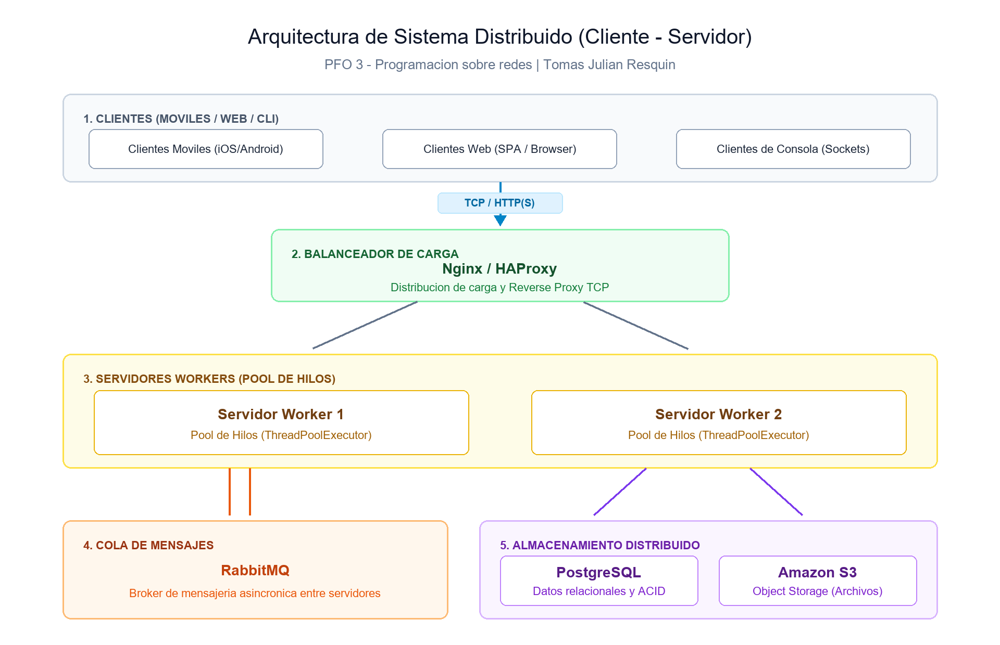

# PFO 3 - Rediseño como Sistema Distribuido (Cliente-Servidor)

**Estudiante:** Tomas Julian Resquin  
**Materia:** Programación sobre redes - 3° D  
**Profesor:** Germán Ríos  

---

## 1. Diagrama de Arquitectura del Sistema



---

## 2. Descripción de Componentes

1. **Clientes (Móviles / Web / CLI):** Puntos de entrada desde donde los usuarios envían peticiones y tareas a través de HTTP o sockets TCP.
2. **Balanceador de Carga (Nginx / HAProxy):** Recibe las conexiones entrantes y las distribuye entre los servidores workers mediante algoritmos de balanceo (Round Robin / Least Connections), evitando sobrecargas en nodos individuales.
3. **Servidores Workers (Pool de Hilos):** Servidores de procesamiento que reciben tareas mediante sockets y delegan su ejecución concurrente a un pool interno de hilos (`ThreadPoolExecutor`), permitiendo atender múltiples clientes en paralelo.
4. **Cola de Mensajes (RabbitMQ):** Intermediario para desacoplar la recepción de tareas del procesamiento pesado, permitiendo comunicación asincrónica y balanceada entre servidores.
5. **Almacenamiento Distribuido (PostgreSQL / S3):** 
   - **PostgreSQL:** Persistencia estructurada transaccional (ACID) con esquemas de replicación primaria/réplica.
   - **Amazon S3:** Almacenamiento distribuido para archivos estáticos y datos binarios.

---

## 3. Ejecución del Prototipo en Python

El prototipo implementa la comunicación cliente-servidor por sockets TCP con distribución de tareas mediante pool de hilos (`ThreadPoolExecutor`):

1. **Iniciar el servidor:**
   ```bash
   python servidor.py
   ```
   *El servidor escucha en `localhost:5000` con su pool de workers listos.*

2. **Iniciar el cliente (en otra terminal):**
   ```bash
   python cliente.py
   ```

### Ejemplo de uso

Desde el cliente interactivo:
```text
Conectado al servidor en localhost:5000

--- Envio de Tareas ---
1. Contar palabras
2. Invertir texto
3. Suma de 1 a N
4. Salir
Selecciona una opcion (1-4): 1
Ingresa el texto: Rediseño de sistema distribuido
Respuesta del servidor: 4 (tiempo: 0.0s)
```
